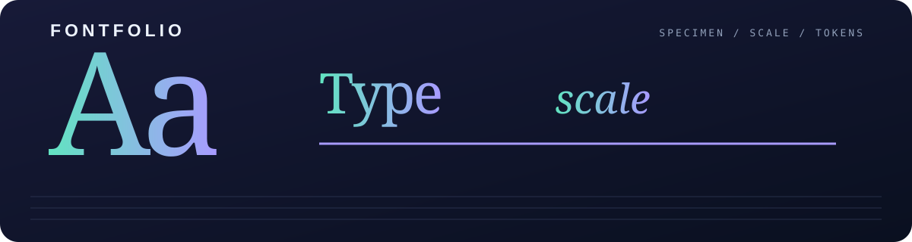

# Fontfolio

A browser-based typography specimen and type-scale studio. Explore installed system fonts, tune a modular scale, and export CSS tokens.

## Features
- Preview common system font stacks available on the current device.
- Adjust base size, modular ratio, font weight, and line height.
- Inspect a live four-step type scale.
- Copy reusable CSS custom properties.
- Responsive and dependency-free.

## Run
Open `index.html` in a modern browser. No install, build, or network access is required.

## Note
Font choices depend on fonts installed on your operating system. Fontfolio does not download or bundle fonts.

## License
MIT